# Aggregate state machines

Version: 1.0 | Frozen: 2026-09-29 | Ticket: [T004](../tickets/004-freeze-domain-contracts.md)

## State-machine rules

- Transitions occur only through named commands and server authorization.
- Each transition checks current state and expected version under transaction/lock.
- Posted states are immutable; correction creates linked records.
- Invalid transition returns `409 invalid_state_transition` with current state and allowed action codes safe for the actor.
- Repeating the same idempotent command returns its original transition result.
- UI labels may be friendly, but stored/API state names below are stable contract values.

## Merchant and subscription

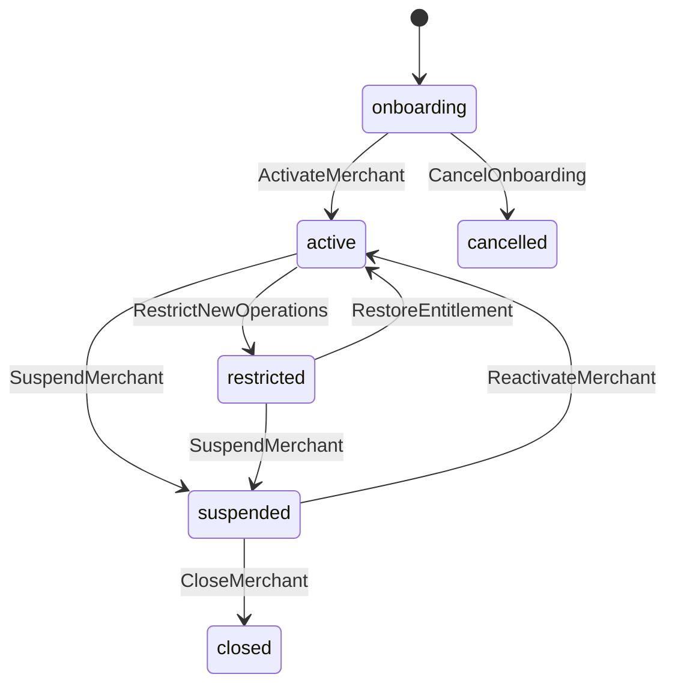

Restriction/suspension cannot discard or prevent recovery/submission of already accepted offline sales. Closing requires exports/retention handling and no unresolved fiscal/offline records.

## Device enrollment and lease

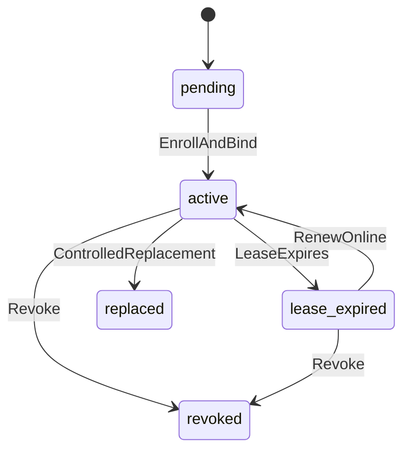

Expired/revoked devices retain read/recovery access to local pending evidence according to the recovery protocol but cannot create new offline sales.

## Settings, catalogue and pricing version

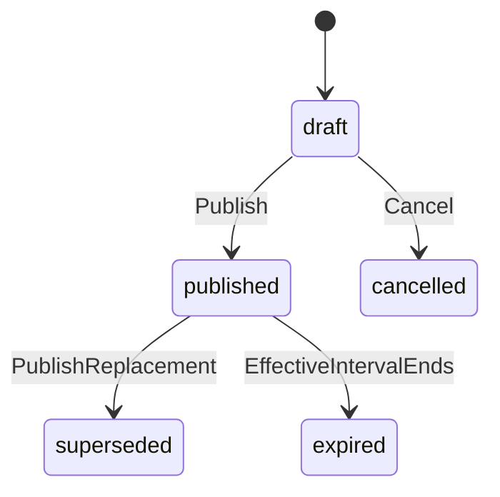

Published versions are immutable. Existing carts explicitly retain/reprice under the owning policy; posted sales keep the used version.

## Cart and suspended cart

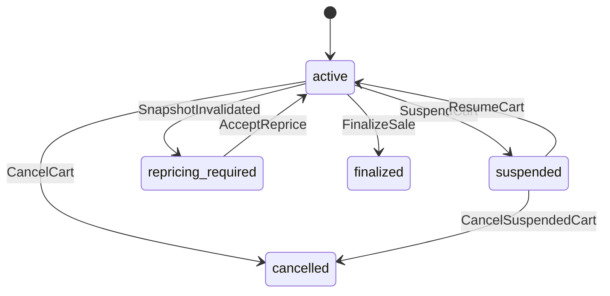

A cart is not a quote, debt or advance. Finalization creates a new posted sale and seals the cart snapshot.

## Sale and tender

Sale states:

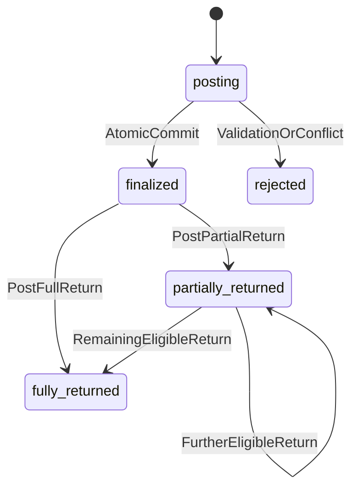

`posting` is normally internal to a transaction/idempotency record. A finalized sale is never changed to cancelled. Tender states are `accepted` or `reversed` with a linked reversal; an external manual tender also stores `confirmation_source=staff_declaration`.

T022 implements the `posting -> finalized` boundary as one database commit. A cart becomes `converted` only in that commit. The response may be lost after commit, so an identical retry or client-transaction lookup returns the already-finalized sale without re-entering `posting`. Receipt `ready`, print `not_requested` and fiscal `not_required` are independent projections rather than sale substates.

## Return and exchange

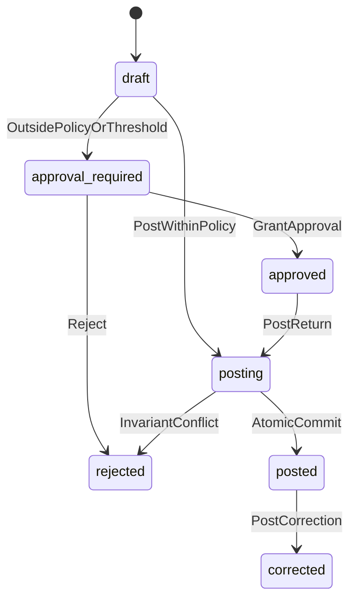

An exchange begins `pending`, then becomes `posted` only when linked return and new sale are posted and the difference is settled. If atomic coordination cannot be maintained, the command fails without leaving one side posted; later tickets must preserve this invariant.

## Register cash session

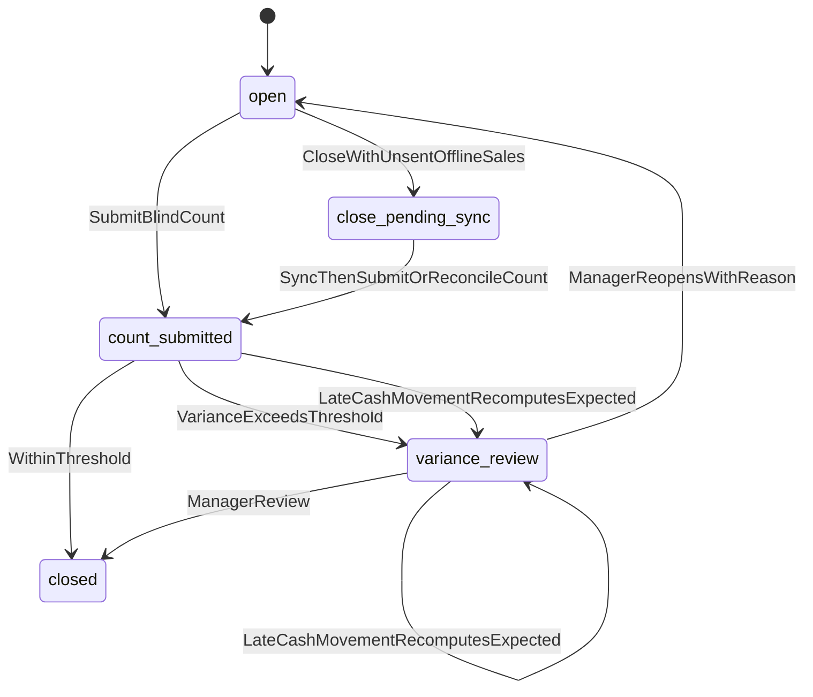

One register has at most one active (`open`, `close_pending_sync`, `count_submitted`, `variance_review`) session. The launch tolerance is zero, so a zero variance passes through `count_submitted` to `closed` in the count command; a non-zero result persists as `variance_review`. Reopening clears the mutable comparison projection while preserving immutable count/review history. Closing never changes posted cash movements. A provisional local close is not labeled server-closed.

## Purchase order and goods receipt

Purchase order:

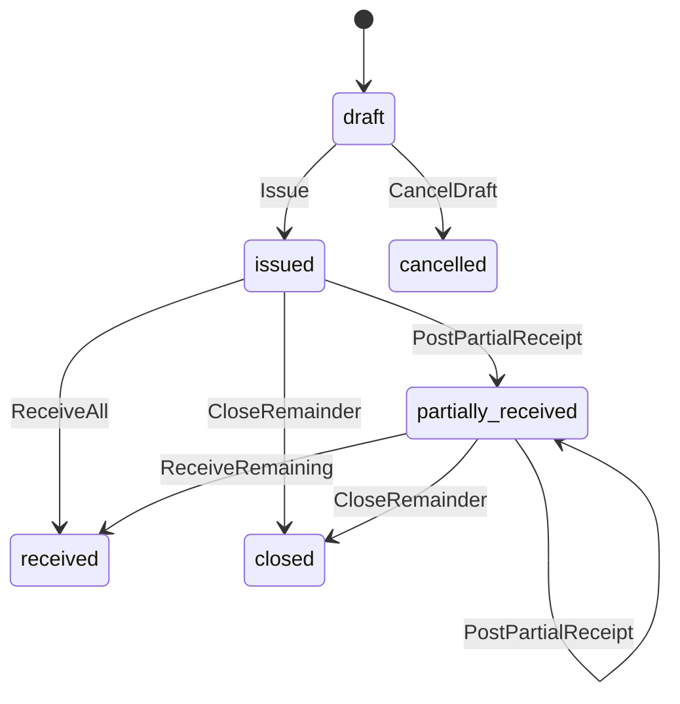

Receipt: `posting -> posted -> reversed`. Eligible quantities are projected as `unreturned`, `partially_returned` or `fully_returned` from linked purchase-return lines rather than rewriting the receipt. A direct receipt reversal is accepted only while its valuation entries are the current tail and the original location/batch still holds the quantity. Issuing a PO never changes stock or supplier liability. Only a posted receipt does.

Purchase return: `posting -> posted -> reversed`. Supplier credit evidence is `expected -> confirmed -> reversed`; an expected credit does not reduce balance. Payment and allocation rows are `posted -> reversed` through linked append-only entries, with no editable intermediate state.

## Stock transfer

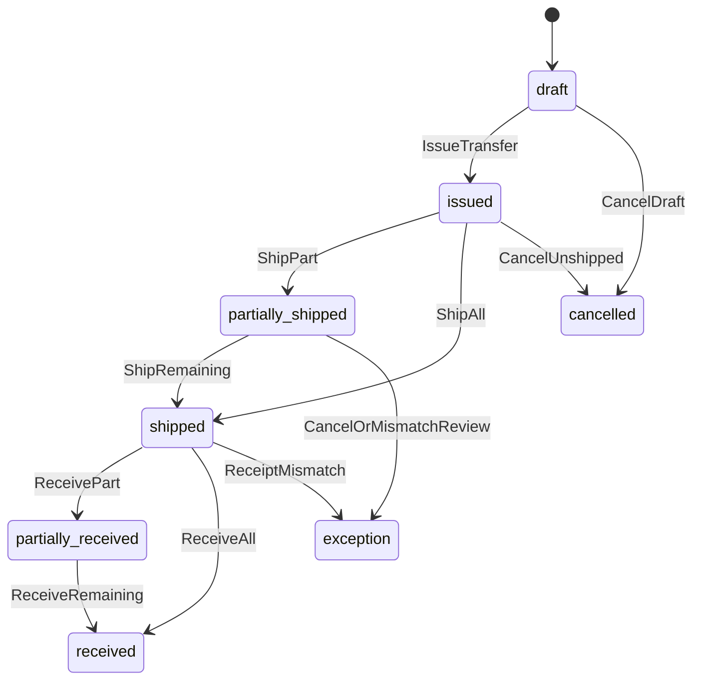

Source movement posts on shipment and destination movement on receipt. Independent stores require mapping before issue.

## Stocktake

`draft -> counting -> review -> posted`, with `cancelled` allowed before posting. Posting creates adjustment movements once. Count edits after posting create another stocktake/adjustment.

## Loyalty redemption and points

Redemption:

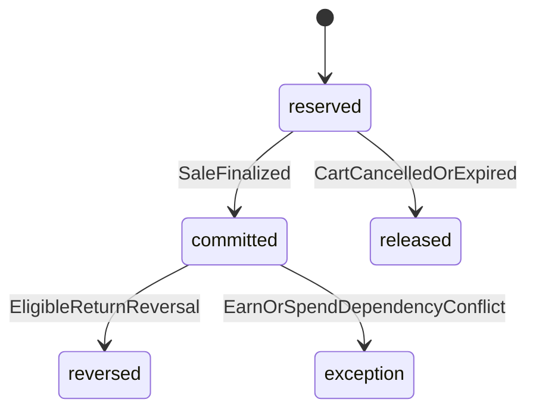

Points ledger entries are posted/reversed, never edited. Offline sales create no spend reservation; earning begins after server sale acceptance.

## Payroll

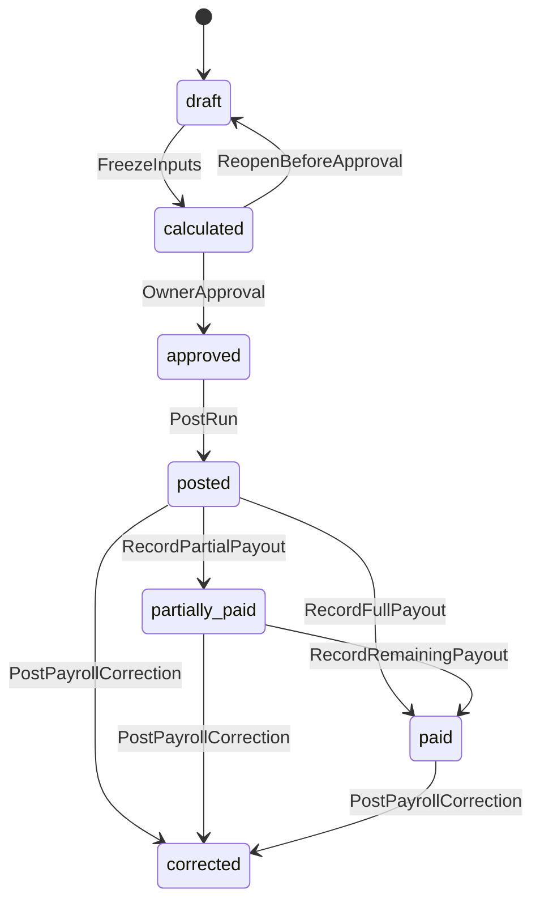

Manager payroll amount access is denied by default. Statutory figures are recorded inputs, not a legal calculation claim.

## Expense and settlement

Expense: `draft -> approval_required|approved -> posted -> reversed`. If paid from a drawer, expense posting and linked cash movement occur once in one transaction. A settlement is `open -> partially_allocated -> reconciled|exception`; it records operational reconciliation, not full accounting.

## Import and export

Import: `uploaded -> validating -> validation_failed|ready -> committing -> committed|commit_failed`. Dry-run has no domain effects. Commit is idempotent per batch and row.

Export: `queued -> running -> ready|failed -> expired`. Download authorization is rechecked; object URLs are short lived.

## Notification delivery and integration

Email delivery uses `queued -> sending -> sent|failed`. SMS/WhatsApp use `queued -> sending -> accepted -> delivered -> read`, with terminal `failed` or `cancelled` where provider evidence supports them. Callbacks may advance a message monotonically; duplicates retain the same delivery/attempt identity. `accepted` or email `sent` means provider handoff, not recipient delivery.

A merchant integration uses `disabled -> active|error -> disabled`. Activation requires complete provider configuration. A safe test may update connection evidence or `error` without exposing credentials. Disabling prevents new work and preserves deliveries/callbacks. Configuration replacement increments the optimistic version.

## Print job

`created -> accepted_by_helper -> printed_reported|failed|outcome_unknown`. Each callback has a globally unique helper event and a job-local attempt number; exact retries replay and changed reuse conflicts. `printed_reported` means helper/device reported success, not independently observed paper. An explicit reprint creates a new audited job with a copy marker and reason but never reposts the sale.

Drawer command: `authorized -> opened_reported|failed|outcome_unknown`. Sale-linked cash drawer authorization exists only on the original print job. Manual no-sale/paid-in/paid-out/diagnostic authorization requires the owning permission, active session, configured capability and a reason. One helper event finalizes one command, so reconnect cannot pulse it again.

## Customer display pairing

Pairing: `pending -> active -> revoked|expired`. Pairing-code expiry blocks activation; active-session expiry blocks reads. Creating another pending pairing revokes and privacy-clears the prior register pairing. Projection: `idle -> cart -> suspended|cancelled|completed -> idle`; cart may update in place with a higher sequence. Suspended/cancelled contain no basket lines. Completed shows only a neutral message, receipt number and total, then clears after 30 seconds. Display state never drives cart or sale state.

## Fiscal document

The binding fiscal state machine is in [fiscal API contracts](../research/fiscal-api-contracts.md): `queued`, `submitting`, `accepted`, `rejected`, `unknown`, `manual_review` and adjustment states. Local sale finality and fiscal state are separate.

## Offline command

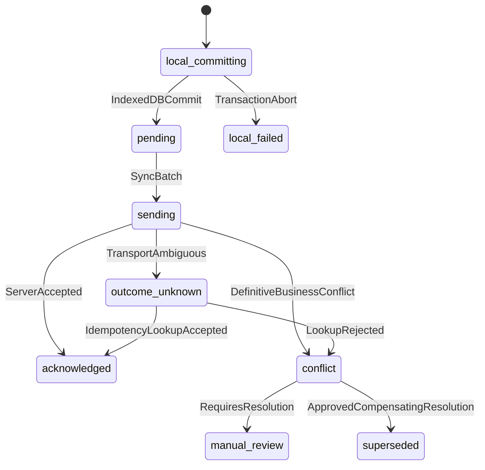

Acknowledged commands and conflicts retain evidence. Logout/update/lease expiry never deletes pending commands.

The implemented server ledger uses `pending -> acknowledged|conflict`. Retryable infrastructure errors leave `pending`; transport ambiguity is represented by the browser retaining/returning the same queued command until the ledger reports its stable result. Exact replay increments the attempt counter and returns the existing resource or conflict. Changed payload reuse returns an identity conflict without rewriting the original record.

## Approval

`issued -> consumed|expired|revoked`. Consumption is atomic with its target command. Approval cannot be transferred to a different actor, store, target or payload.
