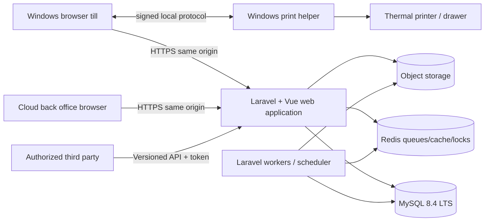

# Architecture, workload and operational recommendation

Version: 1.0 | Researched: 2026-09-28 | Ticket: [T002](../tickets/002-technical-and-product-research.md)

## Recommended system shape

Build MyPoS as a Laravel modular monolith with a same-origin Vue application, MySQL as the system of record, Redis queues/cache/locks, object storage for exports/assets, and an optional signed Windows helper for receipt printers and cash drawers. Keep the till, cloud portal and public API in one deployable application initially while enforcing module boundaries in code and data ownership.

This shape gives transactional consistency for sales, tenders, inventory and cash while avoiding the deployment and distributed-consistency cost of early microservices. Modules communicate through application services, explicit contracts and committed outbox events. They do not join each other's internal tables ad hoc.

Related decisions: [stack versions](stack-versions.md), [offline feasibility](offline-feasibility.md), [hardware feasibility](hardware-feasibility.md), [product comparison](product-comparison.md), [architecture contract](../03-architecture-and-contracts.md), and [data invariants](../05-data-and-domain-invariants.md).

## Context and containers

The offline till also owns a bounded IndexedDB snapshot and outbox. It is not a second authoritative database.

## Module boundaries

Initial bounded modules:

| Module | Owns | May publish |
|---|---|---|
| Identity and tenancy | users, staff memberships, roles, permissions, merchants, stores, registers, device assignments | staff/role/device lifecycle events |
| Catalogue | products, variants, barcodes, units, categories, store assortments | product/version changes |
| Pricing and tax | price books, store prices, tax definitions, promotion rules | pricing snapshot changes |
| Sales | carts at application edge, posted sales, lines, tenders, returns, exchanges, receipt references | sale/return/exchange posted |
| Register and cash | register sessions, opening/closing counts, cash movements | session/cash events |
| Inventory | stock ledger, balances/projections, batches, counts, adjustments, transfers | movement/count/transfer events |
| Purchasing | suppliers, purchase orders, goods receipts and costs | PO and receipt events |
| Customers and loyalty | customer profile, merchant-wide loyalty ledger | customer/loyalty events |
| Reporting | read models, exports and dashboard aggregates | export lifecycle events |
| Integrations | API clients, webhooks, provider mappings, fiscal/payment adapters | webhook/fiscal submission outcomes |
| Audit and operations | audit records, incidents, job/health metadata, retention controls | security/operational alerts |
| Offline sync | device leases, snapshots, command ingestion, acknowledgements and conflicts | accepted/quarantined command events |

Excluded capabilities do not get placeholder modules. Hospitality configuration may alter catalogue labels or till layout, but it must not introduce recipes, kitchen/preparation, tables, reservations, queues or delivery workflows.

## Request and transaction patterns

### Online sale

1. The browser submits a command with idempotency key and expected register/session context.
2. Middleware authenticates the user/session. The server resolves merchant/store/register from trusted membership and assignment.
3. The Sales application service loads authoritative product/pricing/tax rules and asks policy services to authorize the action.
4. One MySQL transaction writes sale header/lines, tenders, inventory movements, register/cash effects, audit metadata and outbox events.
5. The response returns canonical totals, receipt reference and print payload. Printing occurs after commit and cannot roll back the sale.
6. Queue workers consume outbox work idempotently for reports, webhooks, fiscal submission and non-critical side effects.

### Goods receipt

The purchase order records intent. A separate goods receipt posts accepted quantities, batch/cost information and inventory movements in one transaction. Partial receipts accumulate without overwriting the ordered record. Reversal uses a compensating document.

### Return and exchange

An original-sale return references sale lines and remaining returnable quantities. The return posts a negative financial/stock effect with authorization and reason. An exchange links that return to a new sale; it does not edit the original sale.

### Offline ingestion

The server authenticates the enrolled device, validates its lease/snapshot and idempotency envelope, then runs the same domain services as an online command under an offline-ingestion policy. Client-provided tenant IDs, totals and permission claims are not trusted merely because a payload was signed or cached.

## Same-origin authentication and APIs

- Serve the Vue application and Laravel endpoints from one origin for the primary product.
- Use secure, HTTP-only, SameSite cookies and CSRF protection for staff browsers.
- Use Sanctum-compatible session behavior for the first-party SPA. Use revocable, scoped tokens for registered devices and third parties.
- Version public/integration endpoints from their first release. Internal browser endpoints may evolve with the deployed frontend but still use explicit request/response objects.
- Resolve tenant context server-side and include merchant/store scope in database queries, unique keys, audit records and cache keys.
- Authorization lives in policies/application services. Hidden buttons improve UX but do not enforce access.

## Data and consistency

- MySQL InnoDB transactions define atomic posting boundaries.
- Ledger-like records are append-only after posting. Corrections use reversals/compensating records.
- Inventory balance is a projection of movements and may be cached; the ledger is authoritative.
- Money uses integer minor units or fixed decimal according to the domain contract. Quantities and costs use explicit fixed scales. Rounding rules are versioned and tested.
- Client timestamps record observation; server timestamps and business-date rules determine authoritative ordering/reporting.
- Unique idempotency constraints cover all externally retried posting commands.
- An outbox row is inserted in the posting transaction. Workers claim it with bounded retries and stable handlers.
- Reporting reads may use purpose-built projections. They never change transaction history.

## Workload profiles

These are design scenarios for sizing tests, not observed demand or achieved benchmark results.

| Profile | Assumed estate | Assumed catalogue | Peak command/read shape | Purpose |
|---|---|---|---|---|
| P0 development | 2 merchants, 5 stores, 10 registers | 10,000 products per merchant | 2 sale posts/s, 20 reads/s, 30 jobs/min | Local/CI correctness and query inspection |
| P1 pilot | 10 merchants, 30 stores, 60 registers | 50,000 products per merchant; 100,000 in largest operational snapshot | 10 sale posts/s, 100 reads/s, 300 jobs/min; 100 reconnecting devices | Pilot capacity and failure testing |
| P2 launch target | 100 merchants, 300 stores, 600 registers | 2 million product/variant rows total | 50 sale posts/s, 500 reads/s, 2,000 jobs/min; 300-device reconnect wave | Pre-launch load and scale decision point |

Test data must include skew: one large merchant, hot barcode, promotion fan-out, partial purchase receipts, batch lookups, wide reports and offline retry duplicates. Average-only synthetic traffic is insufficient.

## Initial performance objectives

These are service-level objectives to validate later, not T002 test results:

| Interaction | Initial objective | Boundary |
|---|---:|---|
| Cached barcode to cart feedback | p95 <= 100 ms | Browser, catalogue already local |
| Online product search response | p95 <= 300 ms | Server time, common query, P1 load |
| Online sale post | p95 <= 750 ms; p99 <= 1,500 ms | Server receipt, excludes external provider and physical printing |
| Offline local sale commit | p95 <= 250 ms | IndexedDB transaction through confirmed UI |
| Register open/close command | p95 <= 1,000 ms | Server response, excludes operator entry time |
| Common dashboard/list | p95 <= 1,000 ms | Defined filters and warmed application |
| Complex export | start acknowledgement <= 1 s; 95% complete <= 60 s | Asynchronous job within documented row bound |
| Offline ingestion | >= 10 accepted commands/s/device without duplicates | P1 reconnect test, bounded batches |
| Queue delay for critical domain work | p95 <= 5 s | Under P1 steady load |

Every benchmark report records code revision, schema/data shape, environment, concurrency, warm/cold state and error rate. A percentile without that context is not acceptance evidence.

## Availability and recovery objectives

Initial engineering targets, subject to hosting validation:

- Online service target: 99.9% monthly availability for the production application excluding declared maintenance.
- Recovery point objective: <= 15 minutes for authoritative online data through managed database backups plus point-in-time recovery where available.
- Recovery time objective: <= 4 hours for the first production stage, rehearsed before launch.
- Unsynchronized offline records are outside the server RPO until ingested. Register recovery procedures and local storage protection address that risk.
- Critical queue and outbox lag alerts fire before user-facing reports or integrations silently drift.

## Hosting shape and cost assumptions

Recommended progression:

### Development and pilot

- One application node plus one worker process, with separation by process/container rather than service boundary.
- Managed MySQL with backups; Redis 8.2-compatible managed service or a separately operated instance; object storage for exports/assets.
- TLS termination, centralized logs, metrics, error tracking and uptime checks.
- A staging environment using the same database engine and deployment method at smaller capacity.

### Production redundancy

- At least two stateless application nodes behind a load balancer.
- Independent worker capacity and scheduler leader control.
- Managed MySQL high availability and tested point-in-time recovery.
- Managed Redis without Cluster for Horizon, with provider-supported failover where justified.
- Object storage lifecycle/backup policy, offsite configuration/secrets recovery, and tested restore runbook.

Illustrative 2026-09-28 planning ranges:

- Lean pilot: USD 60–150/month before tax, support, email/SMS, monitoring overages and significant egress.
- Redundant early production: USD 200–600/month under the P1/P2 boundary, with managed database HA being a major variable.

These are engineering allowances, not provider quotes. They assume modest compute, managed database, backups, object storage and basic load balancing. DigitalOcean's public pricing on the access date listed Droplets from USD 4/month, managed databases from USD 15/month, Spaces from USD 5/month and load balancers from USD 12/month; actual region, size, backup and HA choices increase the total. Source: [DigitalOcean pricing](https://www.digitalocean.com/pricing), accessed 2026-09-28. Choose a hosting region only after measured Pakistan latency, support, legal/data-residency and provider-service availability checks.

## Observability

Use structured logs with correlation ID, merchant/store/register pseudonymous identifiers, command ID and job ID. Never log credentials, card data, raw auth headers or excessive customer PII.

Minimum signals:

- HTTP rate, latency and errors by route class;
- sale/return/receipt posting outcomes and idempotent retries;
- database connection saturation, slow queries, lock waits and deadlocks;
- queue depth, oldest job, retries, failed jobs and outbox age;
- offline devices, lease age, pending count, conflict reasons and reconnect throughput;
- print-helper versions and failure categories without receipt-sensitive payload;
- fiscal/webhook submission state;
- storage, backup, restore and certificate-expiry checks.

Alerts must point to an owner and runbook. Business dashboards are not substitutes for operational telemetry.

## Deployment and schema change rules

1. Build immutable artifacts from locked dependencies and run static analysis/tests.
2. Backward-compatible database migration lands before code that requires the new shape.
3. Long data backfills run as resumable jobs with progress and load controls.
4. Deploy application nodes gradually; restart workers as Laravel requires.
5. Activate incompatible service-worker/offline-schema updates only through the protocol in [offline feasibility](offline-feasibility.md).
6. Destructive column/table cleanup occurs in a later deployment after old code and offline clients can no longer reference it.
7. Verify application health route, database, queue/outbox and a synthetic authorized transaction path. Laravel documents a built-in health route and the need to reload long-running services during deployment. Source: [Laravel deployment](https://laravel.com/framework/docs/deployment), accessed 2026-09-28.

## Accessibility and both-theme validation

The product targets WCAG 2.2 AA. Every application state must work in the complete light and dark themes defined in [frontend and two themes](../04-frontend-and-two-themes.md).

Required checks per implemented workflow:

- populated, empty, loading, validation, authorization, offline, conflict and server-error states;
- keyboard-only path and visible focus, including till shortcuts and modal focus return;
- accessible name/role/state and announced asynchronous errors/status;
- 200% zoom and reflow at supported till and office viewport sizes;
- text, icon, control, focus-ring and status contrast in both themes;
- no meaning conveyed by color alone;
- Playwright coverage with light/dark emulation plus manual browser/device inspection;
- no flash of the wrong theme before application mount.

WCAG source: [Web Content Accessibility Guidelines 2.2](https://www.w3.org/TR/wcag/), accessed 2026-09-28.

## Security defaults

- Least privilege roles plus explicit high-risk approvals.
- Rate limits and lockouts for authentication, PIN, device and public API endpoints.
- Argon2id/password framework defaults; short cached offline authorization with a slow verifier and attempt limits.
- Content Security Policy, secure headers, output encoding and controlled upload types.
- Encrypted transport everywhere; managed secrets outside source control; key rotation and audit.
- Tenant substitution tests for every protected query/command. Store context is authorized, not accepted from a hidden field.
- Append-only audit of approvals, role changes, no-sale drawer opens, stock/cash adjustments, returns and integration credential changes.
- No card data storage in MVP. Manual external tenders record reference metadata only under the data-minimization contract.

## Rejected shapes for the first release

### Microservices

They add network failure, distributed transactions, service authentication, versioning and operational cost before the team has measured a boundary that needs independent scale or ownership. The modular monolith keeps extraction possible through owned modules and outbox events.

### Separate frontend/API origins

They increase cookie, CORS and token-handling complexity without a product need. The integration API remains independently versioned even though it is deployed with the same application.

### Browser-only silent raw printing

It cannot meet broad Windows printer/drawer requirements reliably. Use the qualified helper path.

### Full offline back office

Purchasing, configuration, returns, loyalty mutation and reporting need current shared truth. Offline scope remains the bounded till flow.

### Client-authoritative totals or inventory

The client provides intent and cached evidence; the server recalculates and posts according to authoritative rules.

## Risks and triggers to revisit

| Risk/trigger | Current mitigation | Revisit when |
|---|---|---|
| One merchant dominates load | tenant-aware indexes, workload skew tests, reporting projections | P2 test misses SLO or operational isolation is required |
| Queue/store bottleneck | separate queues, idempotent workers, non-cluster Horizon Redis | observed saturation or provider limit |
| Reporting harms posting | async exports/read models and query budgets | transactional replica or warehouse has proven need |
| Helper support cost | narrow protocol, qualification list, staged updates | QZ/license/support fails written requirements |
| IndexedDB loss | persistence request, bounded lease, warnings, sync telemetry | browser qualification fails restart/quota tests |
| Country/fiscal change | adapter boundary and pending state | T003 establishes provider contract |

## T004 contract inputs

T004 should convert these recommendations into explicit versioned contracts for:

- same-origin browser sessions and scoped device/integration tokens;
- trusted merchant/store/register resolution;
- online and offline command envelopes with idempotency;
- atomic sale/tender/inventory/cash/outbox posting;
- purchase order versus goods receipt;
- return and exchange linking;
- helper protocol and print outcomes;
- offline lease/snapshot, capacity, update and conflict states;
- error codes, audit metadata, event versioning and compatibility rules.

No UI, API, database migration, integration or hardware change was implemented by this research ticket.
