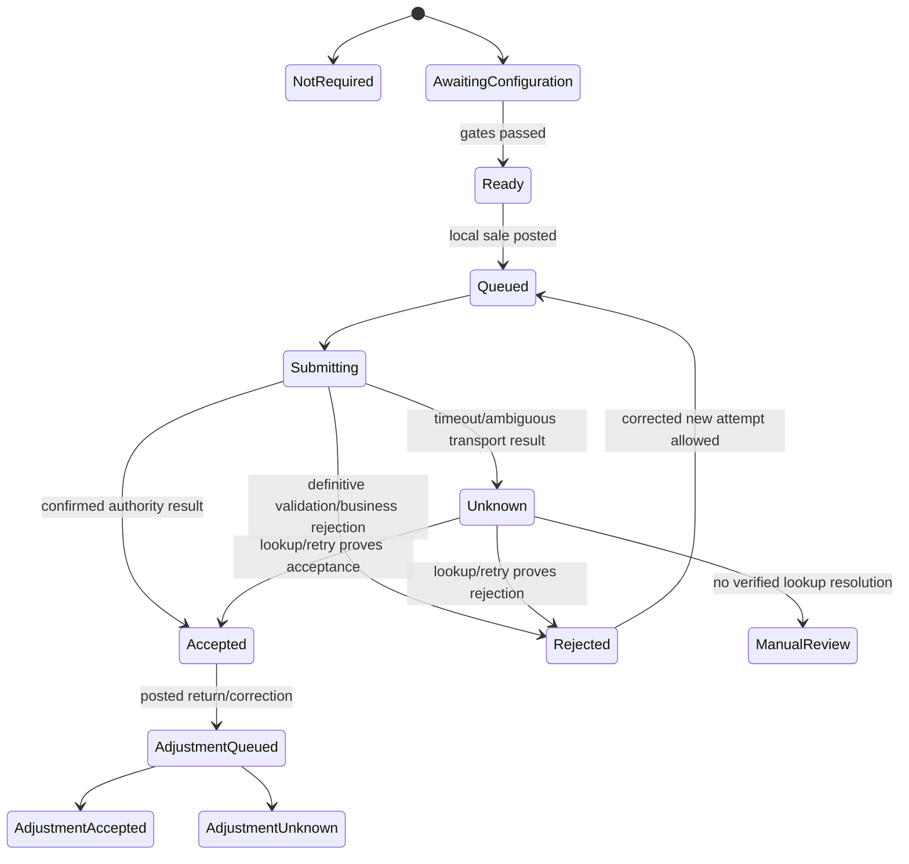

# Fiscal adapter and integration contracts

Version: 1.0 | Researched: 2026-09-28 | Ticket: [T003](../tickets/003-pakistan-fiscal-research.md)

## Contract goal

T004 and T035 need one internal fiscal workflow without pretending the authorities share one API. The internal contract normalizes lifecycle, security and audit behavior; each adapter owns authority-specific payloads, fields, codes, credentials, QR and correction behavior.

This is a proposed contract based on current official documentation. No endpoint was called and no credential was obtained in T003.

## Domain records

### Jurisdiction configuration

```text
FiscalJurisdictionConfig
  id
  merchant_id
  store_id nullable only when rule is merchant-wide
  authority_code
  registration_type
  registration_number
  activity_code
  applicability_status
  legal_basis_reference
  effective_from / effective_to
  adapter_key / adapter_contract_version
  integrator_name / integrator_reference
  price_tax_basis
  outage_policy_code
  receipt_profile_version
  credential_reference
  approved_by / approved_at
  evidence_document_ids
```

Secrets live in a secrets manager or encrypted credential store. `credential_reference` points to them; audit/export screens never reveal them.

### Fiscal document

```text
FiscalDocument
  id
  merchant_id / store_id / register_id
  local_document_type
  local_document_id / local_document_number
  authority_code / configuration_id
  operation: sale | debit_note | credit_note | cancel_or_correct
  original_fiscal_document_id nullable
  local_posted_at / business_date
  payload_schema_version / canonical_payload_hash
  submission_state
  authority_reference nullable
  authority_document_date nullable
  qr_payload_or_url nullable
  accepted_payload_snapshot nullable
  last_error_category / authority_error_code / safe_error_message
  uncertain_since nullable
  attempt_count / next_attempt_at
  accepted_at / rejected_at
```

### Attempt and evidence

Every network attempt is append-only and stores request ID/idempotency key, endpoint class, timestamps, HTTP status, normalized outcome, authority codes, response hash, redacted response evidence and worker/build version. Raw secrets and unnecessary buyer PII are excluded. Retention follows the longest applicable rule; FBR's reviewed rule text specifies six years for electronic invoice and debit/credit-note records.

## Adapter interface

```php
interface FiscalAdapter
{
    public function capabilities(FiscalContext $context): FiscalCapabilities;
    public function validateConfiguration(FiscalContext $context): ValidationResult;
    public function refreshReferenceData(FiscalContext $context): ReferenceDataResult;
    public function mapSale(PostedSale $sale, FiscalContext $context): FiscalPayload;
    public function mapAdjustment(PostedAdjustment $adjustment, FiscalContext $context): FiscalPayload;
    public function validate(FiscalPayload $payload): FiscalResult;
    public function submit(FiscalPayload $payload, SubmissionKey $key): FiscalResult;
    public function lookup(FiscalLookup $lookup): FiscalResult;
    public function renderReceiptEvidence(AcceptedFiscalDocument $document): ReceiptEvidence;
}
```

An adapter declares whether validate, submit, lookup, credit note, cancellation/edit, QR, local middleware and store-and-forward are supported and verified. An unsupported operation fails closed with a stable internal code.

## Fiscal state machine



`unknown` is not `failed`. A timeout after the authority may have committed must never create a second local sale or a different authority document blindly.

## Truthful user-visible states

| Internal state | Till/portal wording | Receipt authority content |
|---|---|---|
| `not_required` | Fiscal integration not applicable under approved configuration | Local receipt only; no authority logo/reference/verification claim |
| `queued` | Sale completed locally — fiscal submission pending | Local sale/receipt number; pending label only if approved by outage contract |
| `submitting` | Submitting fiscal invoice | Do not claim acceptance |
| `accepted` | Fiscal invoice accepted | Authority reference, approved QR/logo/text and accepted timestamp |
| `rejected` | Fiscal submission rejected — action required | No invented authority reference; reprint after resolution follows adapter rules |
| `unknown` | Submission outcome unknown — do not resubmit manually | Preserve local receipt and show reconciliation instruction |
| `manual_review` | Fiscal review required | Never display verified/accepted |

The print service consumes immutable receipt evidence from the fiscal record. It cannot infer acceptance from an HTTP 200 alone; the adapter must parse the documented authority-level status and item statuses.

## Submission semantics

1. The sale is posted once in MySQL with immutable lines, tenders, tax snapshot, inventory/cash effects and an outbox item.
2. The adapter builds a canonical payload from the posted record. Browser values cannot override it.
3. The adapter validates locally against its versioned schema/reference mappings.
4. Where authority validation exists, the worker may call it before post, but validation success is not fiscal acceptance.
5. `submit` records an attempt before sending and records the response in a new transaction.
6. A confirmed authority reference moves to `accepted` only if header and all required item results are valid.
7. A definitive field/business error moves to `rejected` with field-safe remediation.
8. Timeout, connection reset, proxy error, malformed success response or process crash after send moves to `unknown`.
9. Resolve `unknown` through an official lookup if available or through a proven same-document retry rule. Without either, require integrator/authority reconciliation.
10. Never delete accepted fiscal evidence when a local sale is returned or corrected.

## Idempotency and uncertain outcomes

The internal submission key is stable per local fiscal operation. The canonical payload hash is fixed after posting. A worker retry reuses both.

Because not every reviewed authority document exposes a formal idempotency key or lookup API, adapters use a verified authority key:

- FBR DI: local document reference plus immutable payload and returned FBR invoice number; production duplicate/lookup behavior remains a sandbox gate.
- KPRA RIMS: invoice number must be unique per POS ID; credit-note number is unique per branch and the documented credit-note API returns an existing result on duplicate. Invoice duplicate behavior is described as reject or ignore, which is too ambiguous for production until tested.
- SRB/PRA/BRA/ICT: authority-specific keys and lookup behavior remain gated until current technical contracts are obtained.

The application must never automatically generate a new invoice number solely because a retry timed out. That hides duplicates and breaks reconciliation.

## FBR DI v1.12 mapping profile

Verified request fields include invoice type/date, seller NTN/CNIC/name/province/address, buyer identity/name/province/address/registration type, original invoice reference for debit note, and items containing HS code, description, rate, UOM, quantity, inclusive total, value excluding sales tax, fixed/retail price, sales tax, withheld/extra/further tax, FED, discount, sale type and SRO fields. Sandbox adds a scenario ID.

Verified response behavior includes:

- bearer token in `Authorization`;
- distinct sandbox and production post/validate routes;
- FBR `invoiceNumber` and `dated` on valid post;
- header validation status and per-item statuses/error codes;
- HTTP 200, 401 and 500 documented at transport level;
- reference endpoints for province, document type, item, SRO, transaction/sale type, UOM, rate, HS/UOM and registration status/type;
- required Digital Invoicing logo and 1-inch version-2 QR on invoices.

The technical PDF contains examples that must not be treated as merchant rates or valid production master data. Reference data is cached with effective date/version and refreshed under a controlled job. Posted documents retain their resolved values.

Source: [FBR DI Technical Specification v1.12](https://download1.fbr.gov.pk/Docs/20257301172130815TechnicalDocumentationforDIAPIV1.12.pdf), accessed 2026-09-28.

Open FBR questions requiring sandbox/licensed-integrator evidence:

- duplicate post response and supported reference lookup by client document;
- required QR encoded value, because the reviewed page specifies image/version/size but the extracted text does not fully define payload construction;
- exact retail buyer placeholder rules for unregistered end consumers;
- whether cancellation/edit in STGO 01/2026 is exposed through the adapter/API and how audit evidence is returned;
- approved behavior during FBR/integrator/taxpayer connectivity outage;
- token renewal/rotation overlap and revocation;
- interaction for merchants already on legacy Tier-1 POS.

## KPRA RIMS mapping profile

The current official guide documents direct API and a local Windows utility. Core concepts are merchant NTN, POS ID/key, unique invoice number per POS, exclusive amount, tax rate/amount, inclusive total, date/time and optional payment mode. Success returns a transaction ID. QR is constructed from the documented verification URL using POS ID and invoice number. Credit notes link by original invoice number and use a unique credit-note number.

The guide contains conflicting live field mappings (`sales_tax`/`date` versus `tax_amount`/`date_time`). The adapter must generate from the version of the OpenAPI/onboarding contract proven in sandbox and keep that mapping as a named contract version. Do not implement both shapes as silent fallbacks because a retry with another shape can create ambiguity.

Source: [KPRA RIMS technical guide](https://posregistration.kpra.gov.pk/docs), accessed 2026-09-28.

## SRB profile

Current public evidence supports an integrated POS invoice with SRB response/reference and QR, a rate value controlled by current rules, and credit notes for returns/exchanges. Full request/response, authentication, retry, duplicate and outage semantics must be imported from the exact current SRB onboarding pack and proven before implementation is called production-ready.

Sources: [SRB POS API v1](https://www.srb.gos.pk/srb/wp-content/uploads/2026/01/New-POS-API-Document-V1.pdf), [SRB POS FAQ](https://www.srb.gos.pk/srb/faq/), and [SRB Online Integration Rules](https://www.srb.gos.pk/srb/wp-content/uploads/2024/09/Sindh-Sales-Tax-Special-Procedure-Online-Integration-of-Business-Rules-2022-updated-upto-1st-July-2024-EOE.pdf), accessed 2026-09-28.

## Credential and endpoint controls

- Secrets are encrypted at rest, never stored in Git, browser storage, logs, exports or support screenshots.
- Browser tills call MyPoS. They do not hold authority bearer tokens/keys or call public fiscal endpoints directly.
- Each credential is scoped to authority, taxpayer, outlet/POS and environment where supported.
- Sandbox and production secrets, endpoints, data and queues are physically/logically separate.
- Rotation records activation and expiry; test the new credential before retiring the old one where the authority supports overlap.
- TLS certificate verification is mandatory. Endpoint hosts are allowlisted by adapter version.
- Support access to redacted attempts is permissioned and audited.

KPRA's official local utility uses HTTP localhost and merchant key material. If selected, T035 must threat-model local credential storage, origin/process access, installer provenance, version updates and how MyPoS authenticates calls to localhost. Its mere availability does not make the path secure by default.

## Offline and outage contract

An adapter may allow one of:

- `block_sale`: no fiscal-required sale when acceptance cannot be obtained;
- `local_pending`: sale may complete with an explicit pending receipt and must be transmitted within a verified period;
- `authority_middleware_pending`: an official/approved local component accepts and durably queues the invoice;
- `manual_contingency`: only a documented authority contingency procedure, captured outside normal automated claims.

The general MyPoS 72-hour offline lease does not grant fiscal permission. The authority-specific maximum is the tighter bound. KPRA explicitly documents a Windows utility that queues and later syncs, making that path technically feasible subject to sandbox/merchant approval. The reviewed FBR material requires real-time invoicing and gives no sufficiently precise offline exception; FBR-required offline selling stays a launch blocker until written integrator/authority procedure is obtained. The same rule applies to PRA, SRB, BRA and ICT where outage behavior is unverified.

## Tax and rounding fixtures

Each adapter release ships approved fixtures covering:

- inclusive and exclusive prices;
- multiple rates and exempt/zero-rated distinctions;
- line and invoice discounts;
- quantity decimals and unit mappings;
- registered and unregistered buyer cases;
- product/service classification and effective-date transition;
- return/full and partial credit/debit note;
- tax/rounding boundary values and receipt representation;
- mixed local tender methods where the legal rate depends on payment method;
- multi-line partial rejection if the authority supports it.

The PHP calculator, browser display and authority payload use the same golden economic inputs. The server's result remains authoritative.

## Required adapter tests in T035

- Contract tests against captured official sandbox examples and current schema.
- Sandbox submission for every approved business scenario and receipt outcome.
- Invalid credential, expired/revoked credential and wrong outlet/POS.
- Duplicate exact request, duplicate number with changed payload and concurrent retry.
- Timeout before send, after send and after authority commit; process crash before response persistence.
- Header invalid, one line invalid, malformed response, rate limit and server outage.
- Reference-data change and historical replay.
- Credit/debit note before and after allowed correction windows.
- QR/reference verification through the official verification surface.
- Cross-merchant/store credential substitution tests.
- Redaction tests for logs, UI, exports and error monitoring.
- Light/dark, keyboard and screen-reader validation of every fiscal state.

Production evidence records authority, taxpayer test account, adapter version, endpoint environment, timestamp, test case, redacted request/response hash, authority reference and verification result. Simulation is labeled simulation.

